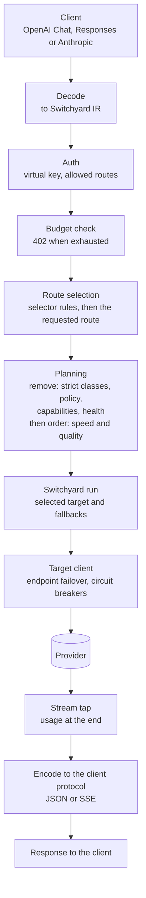
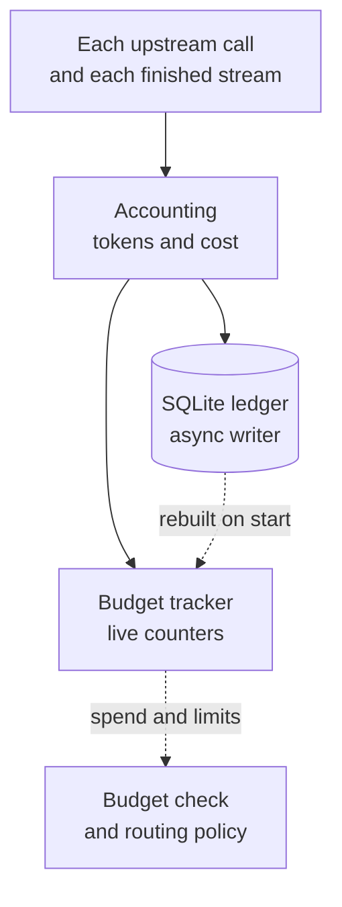
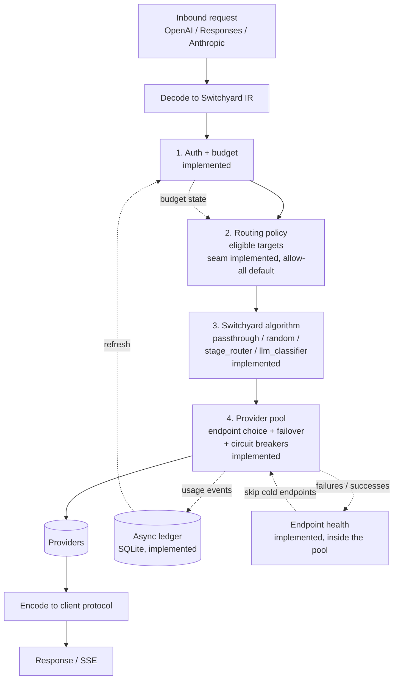

# Architecture

Living document. Update it in the same PR as any change that alters structure, request flow or
component status (see [AGENTS.md](../AGENTS.md)). Diagrams are Mermaid and render on GitHub.

At-a-glance view of what shipped and what is next: [roadmap.md](roadmap.md).

Last updated: 2026-10-22 (`init --out -` in the `init.rs` row; expiring runtime overrides added to the status table as a merged proposal). Earlier, 2026-10-17 (the request-flow diagram redrawn top to bottom and split from the accounting diagram; capability eligibility, ADR 0019; health-driven eligibility, ADR 0018; strict routes, ADR 0017; `/metrics` on one metrics registry, ADR 0016; quota history; roadmap page added). Earlier, 2026-10-10 (roadmap refresh: auto-routing, pool classes with opt-in strict fallback, stickiness, advisory cost-aware ordering and a native Anthropic upstream added; packaging row corrected). Operator-surface order: `/metrics`, health-driven eligibility, native Anthropic upstream, then the admin API and database-managed keys.

## Component status

| Component | Status | OpenSpec change |
|---|---|---|
| Inbound endpoints (OpenAI Chat, Responses, Anthropic) | Implemented | `add-core-gateway` |
| Protocol translation (Switchyard IR/codecs) | Implemented | `add-core-gateway` |
| Streaming proxy over Switchyard's `run` + `TranslatingLlmClient` | Implemented | `add-switchyard-routing` (group 3) |
| TOML config (providers, targets, routes) + CLI (`serve`, `check-config`) | Implemented | `add-core-gateway`, `add-switchyard-routing` (group 2) |
| Switchyard routing: passthrough, random, stage_router, llm_classifier; per-session state; whole-target fallbacks | Implemented | `add-switchyard-routing` (group 4) |
| Provider pool: multi-provider targets with ordered-endpoint failover | Implemented | `add-switchyard-routing` (group 3) |
| Routing-policy seam (eligibility hook, tier substitution, 503 when none eligible) | Implemented | `add-switchyard-routing` (group 5) |
| Virtual keys (hashed, `KeyStore` trait), usage ledger (SQLite, async), per-endpoint pricing | Implemented | `add-cost-tracking` |
| Budgets: UTC daily/monthly USD+token limits, restricted/exhausted states, 402, free-only, `/v1/key/info` | Implemented | `add-cost-tracking` |
| Hot reload: atomic config snapshot swapped on SIGHUP or by polling the file; bad files rejected; health and unchanged routes carried over | Implemented | `add-hot-reload` (ADR 0012) |
| Router decision log: request id, per-request `decisions` table (rule, skipped rules, attempts and fallbacks, refusals, request features), `GET /v1/decisions` per key, retention | Implemented | `add-decision-log` (ADR 0013) |
| `humpyard migrate-modelrelay`: prints a config fragment (providers, targets with strengths and windows, drop-in pool routes) from a ModelRelay's admin API or saved responses; never copies keys | Implemented | `add-migrate-modelrelay` |
| Model discovery: `humpyard models check` and `sync` keep free pools current from a generated file `serve` reads (never fetches); off until switched on globally and per provider | Implemented | `add-model-discovery` |
| Strengths and pool routes: soft target labels and routes whose members are every target with a strength (and optionally a declared minimum context window), resolved when the configuration loads | Implemented | `add-strengths-pools` |
| Latency-ordered routes: a `fastest` route type orders the eligible targets by recently observed time to answer, with exploration, kept in memory from attempts the gateway already times | Implemented | `add-latency-ordering` |
| Honoring stated retry times: a 429 or 503 whose body says when the endpoint will serve again cools it for exactly that long (the header follows Switchyard#904) | Implemented | `add-retry-after` |
| Content conditions for selectors: estimated prompt size, tools, images | Implemented | `add-request-feature-conditions` |
| Routing statistics: `GET /v1/stats` (failure mix, fallback rate, latency percentiles, cost per request by route/target/endpoint, per key) and per-target `recent` numbers in explain; read-only | Implemented | `add-routing-statistics` |
| Route explain: `POST /v1/route/explain` dry run (selected rule, why others did not apply, targets, health, outcome) | Implemented | `add-route-explain` |
| Route selectors: ordered rules choose the route from the key, headers, tags and agent metadata; clients narrow, never widen | Implemented | `add-route-selectors` (ADR 0011) |
| Endpoint health: per-endpoint circuit breaker with cooldown and probe, fail-open, `GET /v1/health` | Implemented | `add-endpoint-health` (ADR 0009) |
| Auto-routing, step 1: one client-facing `auto` route whose selector rules pick the pool by intent (docs and a tested example, no code) | Implemented | `add-auto-routing` |
| Target classes (`private`, `public`, `paid`): decisions and `explain` flag a fallback that crosses classes (observe-only, implemented). Strict routes (`allowed_classes`): targets of other classes are removed before routing, so a private route can never reach a public target (ADR 0017) | Implemented | `add-auto-routing` |
| Session stickiness for clients that send a session id (Claude Code, Codex, `x-switchyard-session-id`); needs investigation, and cannot help clients that send none | Investigate | `add-auto-routing` |
| Cost-aware ordering inside the set rules allow: advisory first (explain reports the choice and why), with exploration; needs prices and weeks of statistics | Planned (after statistics have history) | not yet proposed |
| Native Anthropic upstream (Anthropic Messages to providers without translating to chat completions); Switchyard's client already has an Anthropic backend, so size it by verifying that first | Planned | not yet proposed |
| Health-driven target eligibility: a cold target is skipped when an alternative remains, failing open (ADR 0018) | Implemented | `add-health-eligibility` |
| Capability eligibility: endpoints declare `context_window`, `tools`, `vision`; a target that cannot serve a request is removed before routing, only on certainty (ADR 0019) | Implemented | `add-capability-eligibility` |
| Session and cache analytics: cache numbers on every statistics group, `group_by=session`, and a switch report (cached tokens abandoned when a session changes endpoint, priced from the config), read-only | Implemented | `add-session-analytics` |
| Engineering hardening: invariants + architecture test, lints, structure refactors, CI gates, property tests, ADRs | Implemented | `harden-engineering` |
| Graceful shutdown: drain, grace period, cancel, ledger flush before exit | Implemented | `add-graceful-shutdown` |
| `count_tokens` / `responses/input_tokens`: local, conservative prompt-size estimates (no upstream call). `responses/compact` intentionally not implemented | Implemented | `add-count-tokens`, `add-responses-input-tokens` |
| Packaging: tag-only release workflow (native runners), GHCR image, launchd service; releases published since 0.1.0 | Implemented | `add-packaging` (ADR 0010) |
| Database-managed keys + a versioned, documented admin API (separate admin credential) | Planned (designed for in `add-cost-tracking`) | not yet proposed |
| Expiring runtime overrides: `disable_target`, `drain_provider` and `pin_route` on `/v1/overrides` and `humpyard ctl overrides`, mandatory expiry, audited, subtract-only, per instance (ADR 0025) | Proposed (spec merged, not built) | `add-runtime-overrides` |
| Price import and drift check: `humpyard prices import/check` from public sources (models.dev first), tiered prices, never applied or fetched at runtime (ADR 0014) | Core implemented: `prices import`/`check` against models.dev; tiered prices implemented (cost by prompt size, highest tier for policy); `price_source` in config implemented; the scheduled check still to do | `add-price-import` |
| Quota-aware routing: poll a provider's published usage windows (OpenCode Go first), expose them, and let selector rules match on them; advisory, fails open, measured before use (ADR 0015) | Snapshot, poller, `GET /v1/quota` and stored history (`GET /v1/quota/history`) implemented; measuring now; selector condition after that | `add-quota-routing` |
| `/metrics` endpoint (Prometheus format) on one metrics registry | Implemented | `add-metrics` |
| Read-only status page served by the binary (endpoint health, spend, recent requests) | Planned | not yet proposed |
| Full admin GUI (key and budget management, spend charts) | Later; not ruled out | not yet proposed |
| `migrate-modelrelay` command + bundled catalog | Planned | not yet proposed |

## Direction: operating humpyard

The gateway is configured as code today and observed through `GET /v1/health`, `GET /v1/key/info`
and the SQLite ledger. The planned order for the operator-facing surface is API first:

1. A versioned, documented admin API (OpenAPI generated from the code) with its own admin
   credential and scopes, so a client key can never mint keys. Config-defined keys stay read-only
   in the API. Database-managed keys are credentials bounded by profiles defined in the file: they can
   narrow a profile, never exceed it, always expire, and are revoked immediately
   ([ADR 0025](adr/0025-the-ui-has-no-state-of-its-own.md)); the API exposes the effective configuration with the source of each value and its fingerprint, and
   runtime actions are expiring overrides, never configuration.
2. A `/metrics` endpoint, so existing Prometheus and Grafana setups need no custom UI.
3. A read-only status page served by the binary, built only on the same API.
4. A fuller admin GUI is deliberately left open for later, for people who want one. It should be an
   optional, separate component that is just another client of the admin API, so the core stays a
   single small binary. Nothing above should be built in a way that rules it out.

The rule for any interface is that it keeps no configuration state of its own: structural changes
are patches to the configuration file, operational actions are expiring overrides, and generated
data stays in its own file (ADR 0025). That is what keeps a UI from drifting away from the config.

## Current: request flow (implemented)

The path of one request, top to bottom. Each step can end the request with an error; nothing reaches a
provider before authorization, the budget check and planning have passed.

## Current: accounting (implemented)

What happens to the usage of each call, off the request path. The ledger writer is asynchronous, so a slow
or failing database never delays a response.

## Target: full pipeline (planned order is fixed)

Switchyard decides the macro question (which target); the provider pool answers the micro one
(which endpoint). Policy narrows targets before the algorithm runs; it does not change algorithms.

## Modules (src/)

| Module | Role |
|---|---|
| `config/` | TOML schema (`schema.rs`), cross-field validation (`validate.rs`), pool resolution (`pools.rs`), env-var key loading and the public `Config` (`mod.rs`) |
| `estimate.rs` | Prompt-size estimate for `count_tokens` (pure function over JSON, bytes-per-token ratio calibrated high) |
| `migrate.rs` | `migrate-modelrelay`: parses ModelRelay's `/api/config` and `/api/models` and renders a config fragment (providers, targets, pool routes); used only by that command, never by `serve` |
| `discover.rs` | `models check` and `models sync`: reads the models.dev dataset and each provider's `/models`, plans additions, keeps and removals under guardrails, writes the generated targets file atomically; used only by those commands, never by `serve` |
| `init.rs` | `init`: asks for providers, checks each model against the provider's `/models` and one small request, renders and loads a loopback-only config, writes it to a file (or, with `--out -`, to standard output, with every other message on standard error), proves it with one in-process request; used only by that command, never by `serve` |
| `ctl.rs` | `ctl`: a read-only client for a running gateway; one request per subcommand to an existing endpoint with the caller's key (from the environment, never printed), no redirects, plain HTTP only to loopback; used only by that command, never by `serve` |
| `latency.rs` | Smoothed time to answer per target (answered attempts only) and the ordering a `fastest` route derives from it, with seedable exploration draws |
| `retry_after.rs` | Reads a retry time from an upstream error body (a few well-known phrasings, first 4 KiB, a bounded duration out); the one seam where the `Retry-After` header joins once Switchyard exposes it |
| `num.rs` | Checked integer/float conversions for money and token paths (the only lossy casts) |
| `error.rs` | Gateway errors rendered per client protocol |
| `policy.rs` | `RoutingPolicy` trait, `PolicyContext`, allow-all default |
| `auth.rs` | `KeyStore` trait, config-backed store, key hashing, `keygen` support |
| `budget.rs` | Live per-key counters (UTC day/month), budget states, `BudgetPolicy` |
| `ledger/stats.rs` | Read-only aggregation over decisions and usage: group stats, outcome mix, nearest-rank percentiles |
| `ledger/decisions.rs` | Routing decision rows (one per request), attempts, per-key queries, retention pruning |
| `ledger.rs` | SQLite usage ledger with async batching writer and period queries |
| `metering.rs` | Per-request metered clients, stream tap, answer/judge classification, `Accounting` |
| `pricing.rs` / `clock.rs` | micro-USD cost from usage; clock and UTC periods |
| `server/explain.rs` | The `explain` dry run: reuses selection, budget and policy planning, adds a per-rule trace |
| `server/config_view.rs` | `GET /v1/config`: the effective configuration as JSON with each target's and route's source and the fingerprint, secrets omitted; readable by keys with `read_config` (or any caller on a keyless gateway) |
| `select.rs` | Route selection rules: first-match evaluation of conditions on the key, requested model, headers, tags and agent metadata (pure, no HTTP types) |
| `routing.rs` | Builds one long-lived Switchyard algorithm (and target groups) per route and per bare target; applies policy eligibility, tier substitution and random-weight realignment |
| `pool.rs` | Per-target `RoutedLlmClient`: ordered endpoints, failover, circuit breaking via `health`, provider attribution header |
| `health.rs` | Per-endpoint circuit breaker (cooldown, doubling, single probe) with an injected clock |
| `server.rs` (snapshot, reload) | Router, request stages (decode, authorize, budget, plan, execute, encode), SSE framing, attribution headers; `run` owns the server lifecycle (graceful drain, hard stop, ledger flush) |
| `main.rs` / `lib.rs` | CLI and library root |

Tests: unit tests beside the code; end-to-end suites in `tests/` (shared helpers in
`tests/common/`); `tests/architecture.rs` enforces the layering rules; `tests/switchyard_assumptions.rs`
pins the Switchyard behaviors we rely on; property tests for pricing, budgets and numeric helpers
live in `#[cfg(test)] mod properties` blocks.

## Guardrails

What keeps the structure honest, and where each rule is written down:

- [invariants.md](invariants.md): the rules, each naming its enforcement.
- [adr/](adr/): the durable decisions (immutable).
- CI jobs (all required on `main`): `check`, `deny`, `docs`, `msrv`, `coverage`.
- Lints in `Cargo.toml`: no panics in production code, checked numeric conversions.

## Key decisions

- Reuse Switchyard's IR and codecs instead of hand-written provider types.
- Embed `switchyard-libsy`; the provider pool implements its `RoutedLlmClient` over `TranslatingLlmClient`, and dispatch runs through `switchyard-llm-client::run`.
- Config references API keys by env var only; modelrelay config comes in via a one-shot migration.
- Details and evidence: [background.md](background.md) and `openspec/`.
