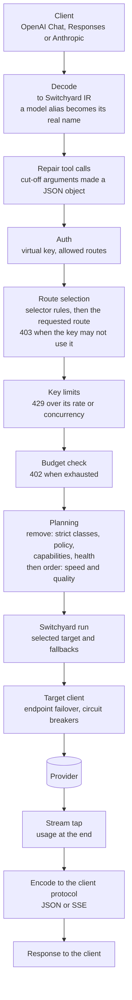
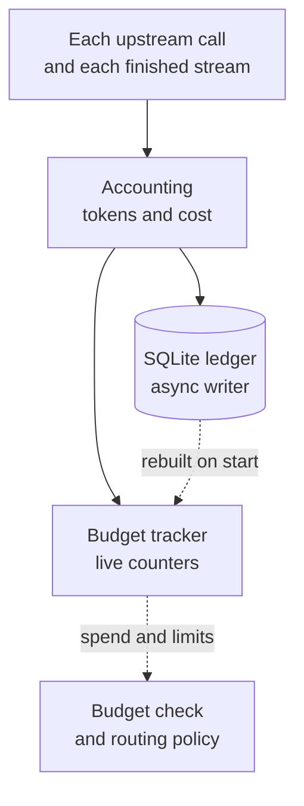
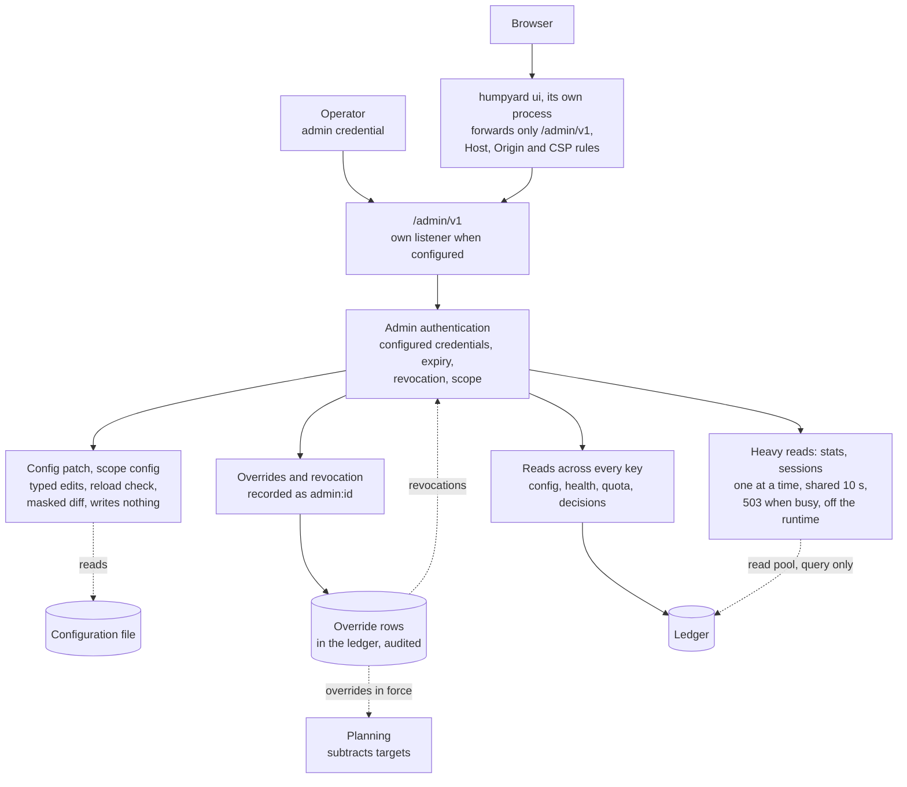
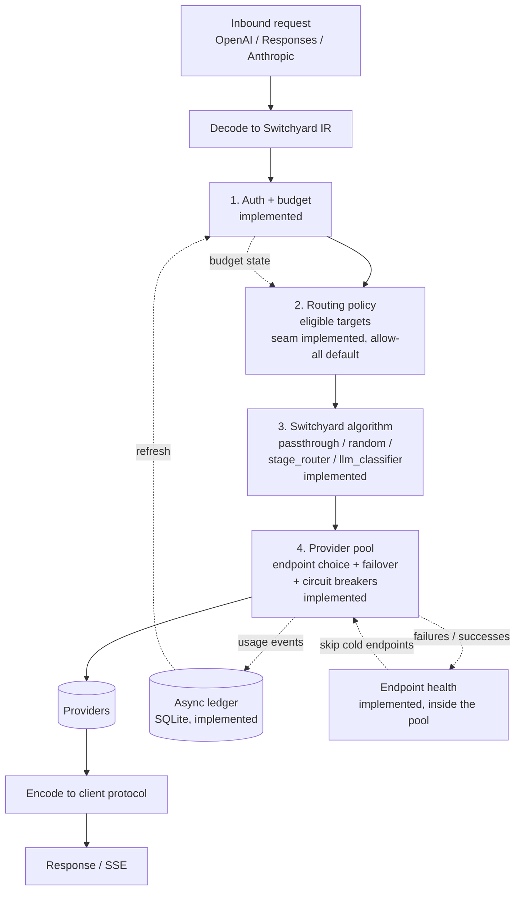

# Architecture

Living document. Update it in the same PR as any change that alters structure, request flow or
component status (see [AGENTS.md](../AGENTS.md)). Diagrams are Mermaid and render on GitHub.

At-a-glance view of what shipped and what is next: [roadmap.md](roadmap.md).

Last updated: 2026-11-12 (change `define-performance-budget`, ADR 0036 and invariant 24: heavy ledger reads run on a read pool of their own, off the serving runtime and behind a gate per surface (`server/heavy.rs`), prunes run in batches on their own task, and `fitness/register.toml` classes every module and says which checks guard it; the module table and the operator-surface diagram. Earlier, 2026-11-09 (release 0.29.0: the admin GUI implemented, change `add-admin-gui-delivery` and ADR 0032: `humpyard ui` serves the page built into the binary and forwards only `/admin/v1`; `ui.rs`, `ui/` modules, `ui_assets.rs` and `build.rs` in the module table, the `ui/` project, the status row and the operator-surface diagram. Earlier, 2026-11-08 (release 0.28.0: configuration patches implemented, change `add-config-patch` and ADR 0034: `POST /admin/v1/config/patch` with the new `config` scope turns typed edits into a validated, masked diff against the configuration file and writes nothing; `config/patch/` and `server/config_patch.rs` in the module table, the reload check shared as `validate_text`, the status rows and the operator-surface diagram). Earlier, 2026-11-08 (release 0.27.0: a provider's per-request cap implemented, change `add-endpoint-request-cap`: `max_request_tokens` on an endpoint, removed in the same planning step as the context window with the reason `request_cap`; the capability row in the status table; no diagram changes). Earlier, 2026-11-08 (release 0.26.0: key profiles implemented, change `add-key-profiles`: `[profiles.*]` and `profile =` on keys, resolved at load in `config/profiles.rs`; the status table and the `config/` row; no diagram changes, the request path reads the resolved key as before). Earlier, 2026-11-07 (release 0.25.0: model aliases, change `gateway-model-aliases` and ADR 0033: an `[aliases.<id>]` name is resolved to its real route or target right after decode, so authorization, selectors, the ledger and the decision log see only real names, and `/v1/models` lists the aliases a key may use; the first request-flow diagram's decode step says so, no other structure changes. Earlier, 2026-11-07 (per-key rate and concurrency limits implemented, change `add-key-rate-limits`: `limiter.rs` in the module table, the status row, and the request-flow diagram now shows the order of checks as the code runs them: authentication, route selection and the key's route allow-list, the limits, the budget, then planning. Earlier, 2026-11-05 (release 0.24.0: `models check --retired` tells a provider with no list or one it cannot reach from an unusable one: `retired.rs` and `discover.rs` rows; no diagram changes). Earlier, 2026-11-05 (release 0.23.0: `humpyard_endpoint_unavailable_total` and `models check --retired`: the `retired.rs` row, the metrics row and the status table; no diagram changes, the check is a command that `serve` never reaches). Earlier, 2026-11-04 (release 0.22.0: the signal counters, the OpenAPI contract and the documentation are out). Earlier, 2026-11-04 (the response-signals change is complete: `signals.rs` in the module table, the two signal counters, the OpenAPI contract and the user documentation). Earlier, 2026-10-29 (release 0.21.0: the timeout change is out, and statistics groups carry the response-signal counts). Earlier, 2026-10-29 (a provider's `timeout_secs` bounds the wait for a response to start and a started stream's idle time, not an answer's length: `pool.rs` row, ADR 0031, no diagram changes). Earlier, 2026-10-28 (each answer is judged for four content-free facts and recorded on its usage row, ledger schema v13, ADR 0030, in progress: `signals.rs`, the tap and the buffered path in `metering.rs`, `response_signals` on decisions; the module table and diagrams follow when the change is archived). Earlier, 2026-10-26 (a cut-off tool call in a request's history is repaired before routing and a decision counts the repairs: `repair.rs` and `repair_request.rs` in the module table, ledger schema v12, ADR 0029; the request-flow diagram gains the repair step). Earlier, 2026-10-25 (a failed attempt records the provider's scrubbed error message: `scrub.rs` in the module table, ADR 0028; no diagram changes). Earlier, 2026-10-25 (the admin API implemented: named, scoped admin credentials in `[admin]`, `/admin/v1` reads across every key, overrides and credential revocation, and a published OpenAPI contract, ADR 0027; `admin.rs` and `server/admin.rs` in the module table; the operator-surface diagram; the Direction section rewritten around it; the status page folded into the admin GUI row). Earlier, 2026-10-24 (per-request cost ceiling on keys implemented, with its row in the status table; runtime overrides implemented and their change archived; `/v1/overrides` and the override step in planning; `init --out -` in the `init.rs` row; expiring runtime overrides added to the status table as a merged proposal). Earlier, 2026-10-17 (the request-flow diagram redrawn top to bottom and split from the accounting diagram; capability eligibility, ADR 0019; health-driven eligibility, ADR 0018; strict routes, ADR 0017; `/metrics` on one metrics registry, ADR 0016; quota history; roadmap page added). Earlier, 2026-10-10 (roadmap refresh: auto-routing, pool classes with opt-in strict fallback, stickiness, advisory cost-aware ordering and a native Anthropic upstream added; packaging row corrected). Operator-surface order: `/metrics`, health-driven eligibility, native Anthropic upstream, then the admin API and database-managed keys.

## Component status

| Component | Status | OpenSpec change |
|---|---|---|
| Inbound endpoints (OpenAI Chat, Responses, Anthropic) | Implemented | `add-core-gateway` |
| Protocol translation (Switchyard IR/codecs) | Implemented | `add-core-gateway` |
| Streaming proxy over Switchyard's `run` + `TranslatingLlmClient` | Implemented | `add-switchyard-routing` (group 3) |
| TOML config (providers, targets, routes) + CLI (`serve`, `check-config`) | Implemented | `add-core-gateway`, `add-switchyard-routing` (group 2) |
| Switchyard routing: passthrough, random, stage_router, llm_classifier; per-session state; whole-target fallbacks | Implemented | `add-switchyard-routing` (group 4) |
| Provider pool: multi-provider targets with ordered-endpoint failover | Implemented | `add-switchyard-routing` (group 3) |
| Routing-policy seam (eligibility hook, tier substitution, 503 when none eligible) | Implemented | `add-switchyard-routing` (group 5) |
| Virtual keys (hashed, `KeyStore` trait), usage ledger (SQLite, async), per-endpoint pricing | Implemented | `add-cost-tracking` |
| Budgets: UTC daily/monthly USD+token limits, restricted/exhausted states, 402, free-only, `/v1/key/info` | Implemented | `add-cost-tracking` |
| Key profiles: `[profiles.<id>]` bundles of routes, budgets, `over_budget` and rate limits that a key inherits and may only narrow (a wider value is refused at load; a profile cannot carry a privilege); resolved at load, shown in `GET /v1/config`; the first half of ADR 0025's keys (database-managed keys are next) | Implemented | `add-key-profiles` |
| Per-key limits: `max_requests_per_minute` (exact 60 s sliding window) and `max_concurrent` (a permit held until the response ends); the request after the limit is a 429 with `Retry-After` before any upstream call and before the budget; per process, kept across a reload | Implemented | `add-key-rate-limits` |
| Hot reload: atomic config snapshot swapped on SIGHUP or by polling the file; bad files rejected; health and unchanged routes carried over | Implemented | `add-hot-reload` (ADR 0012) |
| Router decision log: request id, per-request `decisions` table (rule, skipped rules, attempts and fallbacks, refusals, request features), `GET /v1/decisions` per key, retention | Implemented | `add-decision-log` (ADR 0013) |
| `humpyard migrate-modelrelay`: prints a config fragment (providers, targets with strengths and windows, drop-in pool routes) from a ModelRelay's admin API or saved responses; never copies keys | Implemented | `add-migrate-modelrelay` |
| Model discovery: `humpyard models check` and `sync` keep free pools current from a generated file `serve` reads (never fetches); off until switched on globally and per provider | Implemented | `add-model-discovery` |
| Strengths and pool routes: soft target labels and routes whose members are every target with a strength (and optionally a declared minimum context window), resolved when the configuration loads | Implemented | `add-strengths-pools` |
| Latency-ordered routes: a `fastest` route type orders the eligible targets by recently observed time to answer, with exploration, kept in memory from attempts the gateway already times | Implemented | `add-latency-ordering` |
| Honoring stated retry times: a 429 or 503 whose body says when the endpoint will serve again cools it for exactly that long (the header follows Switchyard#904) | Implemented | `add-retry-after` |
| Content conditions for selectors: estimated prompt size, tools, images | Implemented | `add-request-feature-conditions` |
| Routing statistics: `GET /v1/stats` (failure mix, fallback rate, latency percentiles, cost per request by route/target/endpoint, per key) and per-target `recent` numbers in explain; read-only | Implemented | `add-routing-statistics` |
| Route explain: `POST /v1/route/explain` dry run (selected rule, why others did not apply, targets, health, outcome) | Implemented | `add-route-explain` |
| Route selectors: ordered rules choose the route from the key, headers, tags and agent metadata; clients narrow, never widen | Implemented | `add-route-selectors` (ADR 0011) |
| Endpoint health: per-endpoint circuit breaker with cooldown and probe, fail-open, `GET /v1/health` | Implemented | `add-endpoint-health` (ADR 0009) |
| Auto-routing, step 1: one client-facing `auto` route whose selector rules pick the pool by intent (docs and a tested example, no code) | Implemented | `add-auto-routing` |
| Target classes (`private`, `public`, `paid`): decisions and `explain` flag a fallback that crosses classes (observe-only, implemented). Strict routes (`allowed_classes`): targets of other classes are removed before routing, so a private route can never reach a public target (ADR 0017) | Implemented | `add-auto-routing` |
| Session stickiness for clients that send a session id (Claude Code, Codex, `x-switchyard-session-id`); needs investigation, and cannot help clients that send none | Investigate | `add-auto-routing` |
| Cost-aware ordering inside the set rules allow: advisory first (explain reports the choice and why), with exploration; needs prices and weeks of statistics | Planned (after statistics have history) | not yet proposed |
| Native Anthropic upstream (Anthropic Messages to providers without translating to chat completions); Switchyard's client already has an Anthropic backend, so size it by verifying that first | Planned | not yet proposed |
| Health-driven target eligibility: a cold target is skipped when an alternative remains, failing open (ADR 0018) | Implemented | `add-health-eligibility` |
| Capability eligibility: endpoints declare `context_window`, `tools`, `vision`; a target that cannot serve a request is removed before routing, only on certainty (ADR 0019) | Implemented | `add-capability-eligibility` |
| Per-request cap: an endpoint may declare `max_request_tokens`, a provider's limit on one request, separate from the window; removed on the same rule with the reason `request_cap`; pool filters still read the window | Implemented | `add-endpoint-request-cap` |
| Per-request cost ceiling on keys (`max_request_usd`): a target the request is certain to cost more on is removed before routing, and a request nothing can serve is refused with 402 `request_cost_ceiling` | Implemented | `add-request-cost-ceiling` |
| Decisions keep the provider's scrubbed, bounded error message for each failed attempt, so a request several providers refused can be diagnosed (ADR 0028); no schema change | Implemented (0.18.0) | `record-attempt-errors` (archived) |
| A cut-off tool call in a request's history is repaired before routing, so one bad call cannot make every strict provider refuse a conversation; a decision counts the repairs and keeps nothing of the arguments (ADR 0029); ledger schema v12 | Implemented (0.19.0) | `repair-tool-arguments` (archived) |
| Each answer is judged for four content-free facts (empty, cut by the length limit, a malformed tool call, a stream the provider cut) and recorded on its usage row; decisions list them (ADR 0030); ledger schema v13. Statistics, metrics and the OpenAPI contract follow | Implemented (0.20.0; counters, contract and docs 0.22.0) | `record-response-quality-signals` |
| A provider's timeout bounds the wait for a response to start, a started stream's idle time and a buffered call as a whole, so a healthy long stream is no longer cut at `timeout_secs` (ADR 0031); no configuration change | Implemented (0.21.0) | `bound-the-wait-for-a-response-not-the-whole-stream` (archived) |
| A provider that stops serving a model is visible: `humpyard_endpoint_unavailable_total` counts the attempts it answers with "gone", "key rejected" or "no credit", and `humpyard models check --retired` reports configured endpoints the provider no longer lists (report-only, command-only); no configuration or schema change | Implemented (0.23.0) | `report-retired-model-endpoints` |
| Session and cache analytics: cache numbers on every statistics group, `group_by=session`, and a switch report (cached tokens abandoned when a session changes endpoint, priced from the config), read-only | Implemented | `add-session-analytics` |
| Engineering hardening: invariants + architecture test, lints, structure refactors, CI gates, property tests, ADRs | Implemented | `harden-engineering` |
| Graceful shutdown: drain, grace period, cancel, ledger flush before exit | Implemented | `add-graceful-shutdown` |
| `count_tokens` / `responses/input_tokens`: local, conservative prompt-size estimates (no upstream call). `responses/compact` intentionally not implemented | Implemented | `add-count-tokens`, `add-responses-input-tokens` |
| Packaging: tag-only release workflow (native runners), GHCR image, launchd service; releases published since 0.1.0 | Implemented | `add-packaging` (ADR 0010) |
| Admin API: named, scoped admin credentials in `[admin]` (never a client key or a database row), `/admin/v1` reads across every key, overrides recorded as `admin:<id>`, revocation of a credential without a deploy, and a hand-written OpenAPI document tested against the routes (ADR 0027) | Implemented (0.17.0) | `add-admin-api` (archived) |
| Database-managed keys, bounded by profiles defined in the file (ADR 0025) | Planned | not yet proposed |
| Expiring runtime overrides: `disable_target`, `drain_provider` and `pin_route` on `/v1/overrides` and `humpyard ctl overrides`, mandatory expiry, audited, subtract-only, per instance (ADR 0025) | Implemented (0.13.0) | `add-runtime-overrides` (archived) |
| Price import and drift check: `humpyard prices import/check` from public sources (models.dev first), tiered prices, never applied or fetched at runtime (ADR 0014) | Core implemented: `prices import`/`check` against models.dev; tiered prices implemented (cost by prompt size, highest tier for policy); `price_source` in config implemented; the scheduled check still to do | `add-price-import` |
| Quota-aware routing: poll a provider's published usage windows (OpenCode Go first), expose them, and let selector rules match on them; advisory, fails open, measured before use (ADR 0015) | Snapshot, poller, `GET /v1/quota` and stored history (`GET /v1/quota/history`) implemented; measuring now; selector condition after that | `add-quota-routing` |
| `/metrics` endpoint (Prometheus format) on one metrics registry | Implemented | `add-metrics` |
| Config patches: `POST /admin/v1/config/patch` (scope `config`) applies typed edits to the file's text with a format-preserving editor, loads the result the way a reload does, and returns a masked unified diff and the new fingerprint; writes nothing (ADR 0034) | Implemented (unreleased) | `add-config-patch` |
| Admin GUI: `humpyard ui` serves a page built into the binary (the `ui` feature, `ui/` Preact project) and forwards only `/admin/v1`; Host, Origin and fetch-site rules, an optional held credential behind a per-run token, a strict CSP; the models view first (ADR 0032, [guide](admin-gui.md)). Decisions and overrides views and OIDC sign-in are separate changes | Implemented (models view) | `add-admin-gui-delivery` |
| Performance budget: latency, throughput, memory and isolation budgets, an isolation test that fails CI when administrative reads move the request path, heavy reads on a read pool off the runtime behind a gate per surface, batched prunes, and a fitness register that says which check runs when (ADR 0036) | Implemented | `define-performance-budget` |
| `migrate-modelrelay` command + bundled catalog | Planned | not yet proposed |

## Direction: operating humpyard

The gateway is configured as code today and observed through `GET /v1/health`, `GET /v1/key/info`
and the SQLite ledger. The planned order for the operator-facing surface is API first:

1. **Done:** a versioned admin API with its own credentials and scopes, so a client key can never open it
   (`/admin/v1`, [ADR 0027](adr/0027-admin-authority-is-granted-by-configuration-to-named-scoped-principals.md)).
   Authority is granted by the file to named principals with scopes (`read`, `overrides`, `credentials`, `config`), an
   optional expiry and revocation without a deploy. Its contract is `docs/openapi/admin-v1.json`, served at
   `GET /admin/v1/openapi.json` and tested against the routes. Runtime actions are expiring overrides, never
   configuration ([ADR 0025](adr/0025-the-ui-has-no-state-of-its-own.md)). Structural changes are patches:
   `POST /admin/v1/config/patch` returns a validated diff and writes nothing
   ([ADR 0034](adr/0034-a-configuration-patch-is-typed-edits-checked-by-the-reload-path-and-written-by-no-one.md)).
2. **Done:** a `/metrics` endpoint, so existing Prometheus and Grafana setups need no custom UI.
3. **Done, with more views to come:** an admin GUI, built only on the admin API as a separate client
   (`humpyard ui`, [ADR 0032](adr/0032-the-admin-gui-runs-as-its-own-process-from-the-same-binary.md)). It runs as
   its own process, so the gateway serves no page and CORS never arises; the models view is built. Sign-in
   through an identity provider (OIDC) is a later kind of principal that changes how a caller is recognised, not
   how it is audited or revoked.
4. **Later:** database-managed keys, bounded by profiles defined in the file: they can narrow a profile,
   never exceed it, always expire and are revoked immediately. Nothing in the database may grant admin
   authority.

The rule for any interface is that it keeps no configuration state of its own: structural changes
are patches to the configuration file, operational actions are expiring overrides, and generated
data stays in its own file (ADR 0025). That is what keeps a UI from drifting away from the config.

## Current: request flow (implemented)

The path of one request, top to bottom. Each step can end the request with an error; nothing reaches a
provider before authorization, the key's limits, the budget check and planning have passed.

## Current: accounting (implemented)

What happens to the usage of each call, off the request path. The ledger writer is asynchronous, so a slow
or failing database never delays a response.

## Current: operator surface (implemented)

How an administrator reaches the gateway. The admin credentials come only from the configuration, so neither
authenticator ever falls through to the other, and a revocation lives in the override rows, where nothing that
plans a request can see it.

## Target: full pipeline (planned order is fixed)

Switchyard decides the macro question (which target); the provider pool answers the micro one
(which endpoint). Policy narrows targets before the algorithm runs; it does not change algorithms.

## Modules (src/)

| Module | Role |
|---|---|
| `config/patch/` | Typed edits applied to the file's text with `toml_edit` (`edit.rs`: the section allowlist, limits, all-or-nothing) and the masked unified diff (`diff.rs`); pure, never writes (ADR 0034) |
| `config/` | TOML schema (`schema.rs`), cross-field validation (`validate.rs`), pool resolution (`pools.rs`), key-profile resolution (`profiles.rs`), env-var key loading and the public `Config` (`mod.rs`) |
| `estimate.rs` | Prompt-size estimate for `count_tokens` (pure function over JSON, bytes-per-token ratio calibrated high) |
| `migrate.rs` | `migrate-modelrelay`: parses ModelRelay's `/api/config` and `/api/models` and renders a config fragment (providers, targets, pool routes); used only by that command, never by `serve` |
| `discover.rs` | `models check` and `models sync`: reads the models.dev dataset and each provider's `/models`, plans additions, keeps and removals under guardrails, writes the generated targets file atomically; used only by those commands, never by `serve` |
| `retired.rs` | `models check --retired`: asks each provider for its own `/models` list (through the discovery fetch: key to that provider's host only, no redirects, bounded size and time) and reports configured endpoints whose model it no longer lists; report-only, command-only (ADR 0022) |
| `init.rs` | `init`: asks for providers, checks each model against the provider's `/models` and one small request, renders and loads a loopback-only config, writes it to a file (or, with `--out -`, to standard output, with every other message on standard error), proves it with one in-process request; used only by that command, never by `serve` |
| `ctl.rs` | `ctl`: a client for a running gateway, read-only except `ctl/overrides.rs` (list, add and remove runtime overrides); one request per subcommand to an existing endpoint with the caller's key (from the environment, never printed), no redirects, plain HTTP only to loopback; used only by that command, never by `serve` |
| `ui.rs` / `ui/path.rs`, `ui/guard.rs`, `ui/forward.rs` | `ui`: the admin GUI's server (ADR 0032), one command beside `ctl` that `serve` never reaches (an architecture rule enforces it). `path` normalises a request path and refuses dot segments, `guard` holds the Host, `Origin` and cookie checks and the token sessions (`ui.rs` applies the `Sec-Fetch-Site` rule and the response headers), `forward` sends only `/admin/v1/*` to the gateway with no redirects and bounded time and size; with `--credential-env` it adds the credential behind a per-run token and cookie |
| `ui_assets.rs` / `build.rs` | The GUI's files, looked up by exact path in a set embedded at build time when the `ui` feature is on (the build fails if `ui/dist` is missing); with it off, a placeholder page |
| `ui/` (Preact, TypeScript, Vite) | The GUI's source, a client generated from `docs/openapi/admin-v1.json`; built to static files, never part of the serving path |
| `latency.rs` | Smoothed time to answer per target (answered attempts only) and the ordering a `fastest` route derives from it, with seedable exploration draws |
| `scrub.rs` | Makes a provider's error text safe to keep in a decision (ADR 0028): picks the provider's message out of an error body, flattens it to one line, replaces anything key-shaped and cuts it to 200 characters; used for a decision's own message and for each failed attempt's |
| `repair.rs` | Makes a tool call's argument text a JSON object (ADR 0029): `None` when it already is one, otherwise the cut-off object completed (open string and brackets closed, an unfinished escape, key or comma dropped) or `{}`; one pure scan, depth and size bounded |
| `repair_request.rs` | Applies `repair.rs` to a request: every assistant tool call in the decoded messages and in each preserved same-format body (chat and Responses); returns the count that goes on the decision |
| `retry_after.rs` | Reads a retry time from an upstream error body (a few well-known phrasings, first 4 KiB, a bounded duration out); the one seam where the `Retry-After` header joins once Switchyard exposes it |
| `num.rs` | Checked integer/float conversions for money and token paths (the only lossy casts) |
| `error.rs` | Gateway errors rendered per client protocol |
| `policy.rs` | `RoutingPolicy` trait, `PolicyContext`, allow-all default |
| `auth.rs` | `KeyStore` trait, config-backed store, key hashing, `keygen` support |
| `limiter.rs` | Per-key request-rate and concurrency limits: an exact sliding window of admission times and a `Drop`-released permit carried in the response body, driven by the injected clock, one entry per configured key; carried across a reload by `reloaded`; in memory, per process |
| `budget.rs` | Live per-key counters (UTC day/month), budget states, `BudgetPolicy` |
| `ledger/stats.rs` | Read-only aggregation over decisions and usage: group stats, outcome mix, nearest-rank percentiles; the row fold is private and runs on the blocking pool through `ledger::off_runtime` (invariant 24) |
| `ledger/overrides.rs` | Runtime override rows and their audit trail (schema v9); written at once, not queued, pruned with the decisions, never an override still in force |
| `ledger/decisions.rs` | Routing decision rows (one per request), attempts, the runtime overrides that applied, per-key queries, retention pruning |
| `overrides.rs` | The runtime-override store: kinds, mandatory expiry within `[overrides]` limits, create and revoke with an audit row, credential revocations kept in their own list that planning and clients cannot see, the in-memory set of overrides in force, behind the `OverrideStore` trait so a shared backend can replace the ledger-backed one; `removes` decides what an active override takes out of a route, and `Drains` is what the pool asks, endpoint by endpoint, before trying one |
| `ledger.rs` | SQLite usage ledger with async batching writer and period queries; two pools, the writer's (busy and acquire timeouts of 5 s) and a read pool of `query_only` connections (1 s and 2 s) for statistics and sessions; `off_runtime` for folds; prunes delete in batches of 10,000 on a task of their own |
| `signals.rs` | Judges an answer for four content-free facts (empty, cut by the length limit, a malformed tool call, a cut stream) from chunks or a buffered body; no I/O, bounded memory, nothing of the text kept (ADR 0030) |
| `metering.rs` | Per-request metered clients, stream tap, answer/judge classification, `Accounting` |
| `pricing.rs` / `clock.rs` | micro-USD cost from usage; clock and UTC periods |
| `server/heavy.rs` | `HeavyReads`: one heavy read at a time per surface (administrative, client), a second answered 503 `admin_busy` / `stats_busy` with `Retry-After`, identical reads sharing one result for ten seconds, `computed_at_ms`; `try_run` for optional work |
| `server/explain.rs` | The `explain` dry run: reuses selection, budget and policy planning, adds a per-rule trace; its recent per-target numbers come from a heavy read taken only if the client gate is free |
| `server/overrides.rs` | `/v1/overrides`: create, list and remove runtime overrides; checks the caller's `manage_overrides`, that the ledger exists, and that the subject exists in the configuration being served and a pin adds no reach |
| `admin.rs` | Admin authentication (ADR 0027): resolves a presented secret to a principal (id, scopes, expiry) from the configured admin credentials only, never a client key, and builds the `[admin.credentials.<id>]` block `keygen --admin` prints |
| `server/admin.rs` | `/admin/v1`: the route table (`ROUTES`) the router is built from, per-route scope checks, 401 `admin_credential_invalid` and 403 `admin_scope_required`, the read endpoints across every key, overrides recorded as `admin:<id>`, credential revocation, and `/admin/v1/openapi.json` |
| `server/config_patch.rs` | `POST /admin/v1/config/patch` (ADR 0034): authenticates the `config` scope before reading the body, bounds it, checks the file's fingerprint, applies the edits, runs the reload's check and a throwaway build of the serving state, and answers with a masked diff; no write path |
| `server/config_view.rs` | `GET /v1/config`: the effective configuration as JSON with each target's and route's source and the fingerprint, secrets omitted; readable by keys with `read_config` (or any caller on a keyless gateway) |
| `select.rs` | Route selection rules: first-match evaluation of conditions on the key, requested model, headers, tags and agent metadata (pure, no HTTP types) |
| `routing.rs` | Builds one long-lived Switchyard algorithm (and target groups) per route and per bare target; applies policy eligibility, tier substitution and random-weight realignment |
| `pool.rs` | Per-target `RoutedLlmClient`: ordered endpoints, failover, circuit breaking via `health`, provider attribution header; endpoints on a provider a runtime override has drained are never tried. It applies each provider's `timeout_secs` itself (ADR 0031): the wait for a response to start, retries included, the idle time of a stream that has started, and the whole of a buffered call; the client library's own deadline is off |
| `health.rs` | Per-endpoint circuit breaker (cooldown, doubling, single probe) with an injected clock |
| `server.rs` (snapshot, reload) | Router, request stages (decode, tool-call repair, authorize, key limits, budget, plan, execute, encode), SSE framing, attribution headers; `run` owns the server lifecycle (graceful drain, hard stop, ledger flush) |
| `main.rs` / `lib.rs` | CLI and library root |

Tests: unit tests beside the code; end-to-end suites in `tests/` (shared helpers in
`tests/common/`); `tests/architecture.rs` enforces the layering rules; `tests/switchyard_assumptions.rs`
pins the Switchyard behaviors we rely on; property tests for pricing, budgets and numeric helpers
live in `#[cfg(test)] mod properties` blocks.

## Guardrails

What keeps the structure honest, and where each rule is written down:

- [invariants.md](invariants.md): the rules, each naming its enforcement.
- [adr/](adr/): the durable decisions (immutable).
- CI jobs (all required on `main`): `check`, `deny`, `docs`, `msrv`, `coverage`.
- Lints in `Cargo.toml`: no panics in production code, checked numeric conversions.

## Key decisions

- Reuse Switchyard's IR and codecs instead of hand-written provider types.
- Embed `switchyard-libsy`; the provider pool implements its `RoutedLlmClient` over `TranslatingLlmClient`, and dispatch runs through `switchyard-llm-client::run`.
- Config references API keys by env var only; modelrelay config comes in via a one-shot migration.
- Details and evidence: [background.md](background.md) and `openspec/`.
