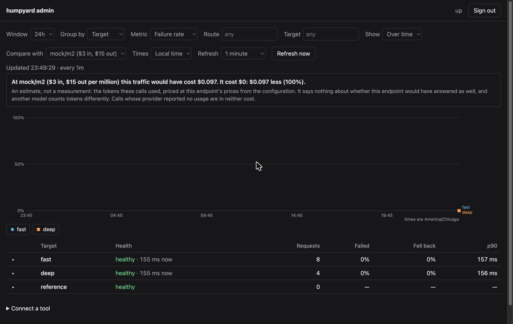

# On one machine: `humpyard up`

`humpyard up` is the shortest way from a downloaded binary to a gateway you can see working. One command writes a first
configuration if you have none, starts the gateway and the [admin GUI](admin-gui.md) together, and opens the GUI already
signed in. It is for one person on one machine: everything listens on `127.0.0.1`. To serve other people or other
machines, use [`humpyard serve`](deployment.md) with keys and budgets.

```sh
export GROQ_API_KEY=...        # optional: or paste the key into the page
humpyard up
```

You can also run it with no key at all and add one in the page.

## What happens

1. **A configuration.** If `~/.config/humpyard/config.toml` does not exist, `up` looks for a key for each built-in
   provider (`GROQ_API_KEY`, `OPENROUTER_API_KEY`, `NVIDIA_API_KEY`, or one you name with
   `--custom NAME,BASE_URL,KEY_ENV,MODEL`), checks each provider's models live, and writes the same loopback-only file as
   [`humpyard init`](deployment.md#first-config-humpyard-init), with a `fast` and a `deep` target. It never overwrites a
   file you have.
2. **The gateway** starts as a child process on `127.0.0.1:8080`, and **the GUI** on `127.0.0.1:8787`. The gateway serves no web
   page; `up` serves the page. If an address is taken, `up` starts nothing and says which flag to change
   (`--listen`, `--ui-listen`).
3. **The browser** opens on a link that signs you in. There is no credential to paste or create: `up` makes an admin
   credential for each run, gives the gateway only its hash, and forgets it when it stops.
4. **The page** opens on *Connect a tool* (copy-paste settings with your live address filled in), a *Send a test request*
   button, and, once something has gone through, the [query view](admin-gui.md#the-query-view).



*Twelve requests through a mock provider; the comparison is against a priced endpoint in the configuration.*

Press Ctrl-C to stop. The gateway is stopped with `up`.

## Keys

A key can come from three places, and the page says which one each provider is using:

| Where | Lasts | How |
|---|---|---|
| Your **environment** | as long as you keep it exported | `export GROQ_API_KEY=...` before `humpyard up`. This always wins. |
| **This run only** | until `up` stops | Paste it in the page and leave *Use for this run only* chosen (the default). It is held in memory and written nowhere. |
| **Saved on this machine** | until you remove it | Paste it in the page and choose *Save on this machine*. |

A key you paste is checked with its provider first (it must list its models and answer one small request); one that is
refused is not kept. After it is accepted the gateway restarts to pick it up, which takes a moment. A key is never shown
again, by the page or by anything else: the page only says whether a provider has one and where it comes from.

Saved keys go in one file, `~/.config/humpyard/keys.env`, in a directory only you can use (`0700`) with the file readable
only by you (`0600`). It is the only secret humpyard ever keeps. Only `humpyard up` reads it: `humpyard serve`, `ui`
and `ctl` never do, and the configuration still names an environment variable for each key and never holds one
([ADR 0039](adr/0039-a-local-key-file-is-read-only-by-up-and-never-shown-again.md)). Remove a saved key with the page's
*Remove* button, or delete the file. If `up` finds the file or its directory readable by others it refuses to use it and
says what to run.

If you serve the page beyond this machine (`--ui-listen` on a non-loopback address, which also needs `--allow-host`), key
entry is switched off.

## Where things are

| | |
|---|---|
| `~/.config/humpyard/config.toml` | your configuration (`--state-dir` changes the directory). `up` never edits it. |
| `~/.config/humpyard/keys.env` | the keys you chose to save, if any |
| `~/.config/humpyard/ledger.db` | the usage ledger, unless your configuration names one |
| `~/.config/humpyard/run/` | the current run's generated configuration (it holds a hash, not the credential); removed when `up` stops |

## Limits

- **Your configuration must have no `[admin]` section.** `up` adds its own admin credential for the run and will not edit
  yours. If you already manage admin credentials, run `humpyard serve` and `humpyard ui` yourself.
- **Loopback only.** Anyone who can open a connection to `127.0.0.1` on this machine can send requests through the gateway:
  there are no client keys on a single-machine setup. On a shared machine use `serve`.
- **Claude Code needs a provider that takes large requests.** Its first request is about 22,000 tokens. Groq's free tier caps a
  request at 8,000 tokens, so it answers 413 (Claude Code words that as "Request too large"); use NVIDIA or another provider
  with a larger limit. OpenRouter's free models only appear if the account allows free endpoints (not with zero data retention).
- **A key change restarts the gateway**, and a request in flight at that moment may fail.
- **Stop it with Ctrl-C (or `kill`, not `kill -9`).** The gateway is a child of `up`; if `up` is killed outright the gateway keeps
  running, and the next `humpyard up` says its address is in use until you stop it (`pkill -f 'humpyard serve'`).

Then connect a tool: [Claude Code, Codex and others](clients.md).
