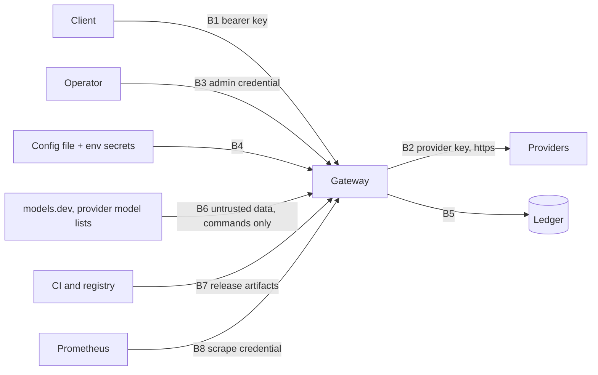

# Threat model

What humpyard protects, from whom, and where the protections live. It is meant to be short enough to read in
ten minutes and to be updated whenever a trust boundary moves; a change that touches authentication, a network
listener, secrets, or the parsing of untrusted data carries its own threat model in its `design.md` and updates this
page when it lands. The rules that must keep holding are in [Architecture invariants](invariants.md); this page says
which threats they answer and which threats nothing answers yet.

## The system in one paragraph

Clients send LLM requests with a bearer key to the gateway. The gateway authenticates the key, applies the key's
route and budget limits, picks a target, calls the provider with the **gateway's own** provider key, and records a
usage row and a decision in a local ledger. Operators configure it through a file (and secrets through the
environment), read it through the admin API (`/admin/v1`, its own credentials), `humpyard ctl`, and `/metrics`.
Optional commands read public price and model lists (`prices`, `models`). Release artifacts are built in CI.

## Assets

| Asset | Why it matters |
|---|---|
| Provider API keys | They spend the operator's money and carry the operator's identity at each provider |
| Client keys (stored as SHA-256 hashes) | They authorise spend through the gateway, within route and budget limits |
| Admin credentials (hashes in the file) | They can create overrides and revoke credentials; one with the `config` scope can ask for configuration patches, which write nothing |
| Prompts and responses | They may contain anything the user sent; the gateway does not store them |
| The ledger (SQLite) | Key ids, models, token counts, costs, decisions with scrubbed provider error text |
| The configuration and generated target file | They decide where prompts go; a poisoned one sends them elsewhere |
| Release artifacts and the container image | What operators run |

## Actors

The operator; a legitimate client; a malicious or compromised client key; a provider (trusted to answer, not
trusted for what it returns); a compromised provider or an attacker in the path to one; a public data source
(models.dev, a provider's model list); anyone who can reach a listener; a local user or process on the gateway's
host; a dependency or build-tool maintainer.

## Trust boundaries

## Threats and what answers them

"Enforced by" names the invariant, test or ADR that keeps the mitigation true. **Gap** marks a threat with no
sufficient answer today; they are collected at the end.

### B1: client to gateway

| Threat | Mitigation | Enforced by |
|---|---|---|
| Spend or use without a valid key | Bearer keys, stored only as SHA-256 hashes; authentication, route allow-list and budget are checked before any upstream call | Invariants 5 and 8; `tests/auth.rs`, `tests/budget.rs` |
| A key leaks through logs or the ledger | Logs name the key id and never the key or its hash; the ledger holds key ids, never hashes | Invariants 8 and 10; `tests/auth.rs` (`logs_name_the_key_id_but_never_the_key_or_its_hash`) |
| Guessing a key | Keys are random 256-bit values from `keygen`; a lookup is by the hash of the presented key, so timing reveals nothing usable about the key | `tests/cli.rs` (`keygen`) |
| One key hammering the gateway, or holding many slow streams open | Optional per-key `max_requests_per_minute` and `max_concurrent`, checked after authentication and before the budget and any upstream call; the concurrency permit is released by `Drop` however the response ends | Invariant 5; `tests/key_rate_limit.rs`, `tests/key_concurrency.rs`, `tests/key_limits_reload.rs`. Residual: counters are per process (reset on restart, multiplied by replicas) and a holder of several keys has several allowances |
| A key is given more authority than intended, or a profile edit widens keys silently | A key inherits its profile's settings and can only narrow them: a wider value, an unknown profile, or a privilege in a profile is refused when the file loads, and a reload that would do so is refused as a whole | `src/config/tests.rs` (per setting), `tests/key_limits_reload.rs` (a refused reload keeps the old limits), [ADR 0025](adr/0025-the-ui-has-no-state-of-its-own.md). Residual: each key has its own counters, so many keys on one profile multiply its allowance (`max_active_keys` comes with database-managed keys) |
| Many failed authentication attempts | None | **Gap:** failed authentication is not throttled (a limit keyed by source address is inert behind a proxy and would lock out everyone); keys from `keygen` are 256 random bits, so guessing is not feasible, and a weak hand-chosen secret is the operator's error ([ADR 0025](adr/0025-the-ui-has-no-state-of-its-own.md) lists limits for database-managed keys) |
| An oversized request exhausts memory | A request body above 2 MB is refused with 413 | **Gap:** this is the web framework's default, not a setting or a tested invariant; it also refuses large multimodal requests, which may not be wanted |
| A client routes around a strict (private-only) route | The policy narrows targets by class before any algorithm runs | Invariant 6; `tests/policy.rs`; [ADR 0017](adr/0017-strict-routes-exclude-disallowed-classes-before-routing.md)
| A client reaches a route its key may not use by asking for it under an alias, or learns of one from `/v1/models` | An alias is resolved to its real name before authorization, so the allow-list is checked on the real name; the list shows an alias only when the key may use its target; aliases cannot collide with a real name or point at another alias | [ADR 0033](adr/0033-model-aliases-are-resolved-once-at-the-edge.md); `tests/model_aliases.rs` (`the_allowlist_is_checked_on_the_real_name`, `models_lists_the_aliases_a_key_may_use_with_their_labels`); `src/config/tests.rs` (alias validation) |
| One key overspends | Per-key and per-request budgets, integer micro-USD accounting | Invariant 9; `tests/budget.rs` |
| Strings a client chooses (model name, session id) reach an operator's screen or a metric label | Metrics never use client strings as labels; the planned GUI renders every string as text | [ADR 0016](adr/0016-metrics-are-one-registry-with-bounded-labels.md); `tests/metrics_registry.rs` (`a_clients_strings_never_become_labels`) |
| Prompts or responses are disclosed from storage | Nothing of the content is stored; decisions keep one scrubbed, bounded line of provider error text | [ADR 0013](adr/0013-decisions-recorded-per-request.md), [ADR 0028](adr/0028-a-decision-keeps-the-providers-scrubbed-error-text-for-each-failed-attempt.md); **Gap:** no test asserts that no ledger column can hold content |

### B2: gateway to providers

| Threat | Mitigation | Enforced by |
|---|---|---|
| A provider key reaches the wrong host | A provider key is sent only to that provider's own origin; quota polling and the model-list fetches send it only over https and do not follow redirects | Invariant 4b; `tests/quota.rs`; `tests/models_retired.rs` (`the_key_goes_only_to_the_providers_own_host_and_redirects_are_not_followed`); **Gap:** for chat calls this relies on the HTTP client's defaults, with no test |
| A provider returns hostile or malformed data (tool-call arguments, error text, endless streams) | Tool-call arguments are repaired within bounds, error text is scrubbed and bounded, the response judge keeps bounded memory, a stream's idle time is bounded | [ADR 0029](adr/0029-the-gateway-repairs-invalid-tool-call-arguments-in-a-requests-history.md), [ADR 0028](adr/0028-a-decision-keeps-the-providers-scrubbed-error-text-for-each-failed-attempt.md), [ADR 0030](adr/0030-response-quality-is-recorded-as-content-free-flags-per-call.md), [ADR 0031](adr/0031-a-providers-timeout-bounds-the-wait-to-start-and-a-streams-idle-time.md); `src/signals.rs` limits |
| Prompts go to a third party the operator did not intend | `private` routes are strict: only targets of the allowed classes are eligible | [ADR 0017](adr/0017-strict-routes-exclude-disallowed-classes-before-routing.md); the operator's route configuration |
| A slow or failing provider denies service | Timeouts, failover and endpoint health; health never denies service | Invariant 14; `tests/health.rs` |

### B3: operator to gateway (admin API, `ctl`)

| Threat | Mitigation | Enforced by |
|---|---|---|
| A client key reaches the admin API | The admin and client authenticators never consult each other's credentials; admin authority lives only in the file | [ADR 0027](adr/0027-admin-authority-is-granted-by-configuration-to-named-scoped-principals.md); admin API tests |
| An admin credential leaks | Hashed, scoped, optionally expiring, and revocable as an expiring override without a deploy | [ADR 0027](adr/0027-admin-authority-is-granted-by-configuration-to-named-scoped-principals.md); **Gap:** no rate limit on failed admin authentication |
| The admin credential or API is exposed in cleartext | The admin API can have its own listener | **Gap:** the gateway speaks plain HTTP and expects TLS from a reverse proxy; the deployment guide does not say so plainly |
| An admin action is not attributable | Admin actions are audited as `admin:<id>` | [ADR 0027](adr/0027-admin-authority-is-granted-by-configuration-to-named-scoped-principals.md)
| A `config` credential is used to edit authority: a new admin credential, a changed key hash, a new key | Only named sections are editable; the `admin` table is not; under `keys` only `set` and `remove`, never `sha256`, never adding or removing a key; a rejected edit applies nothing | [ADR 0034](adr/0034-a-configuration-patch-is-typed-edits-checked-by-the-reload-path-and-written-by-no-one.md); invariant 23; `tests/config_patch.rs` (`edits_outside_the_editable_sections_are_refused_naming_the_edit`) and the `config::patch` unit tests |
| A patch answer shows a key hash, a credential hash or a provider header value | The diff is computed on texts masked by walking the parsed document; loader and parser messages have the file lines they quote removed | `config_patch.rs` (`removing_a_provider_shows_its_header_without_the_value`, `a_hash_near_an_edit_is_masked_in_the_context`, `a_loader_error_never_echoes_a_line_of_the_file`); the `config::patch` diff tests |
| A patch changes the file, reloads or alters the running gateway | The endpoint has no write path and no reload trigger; every outcome is checked to leave the file, fingerprint and reload status as they were | invariant 23; `config_patch.rs` (`no_outcome_writes_the_file_reloads_or_changes_the_running_configuration`) |
| A `config` credential reads the file's structure by probing diffs | **Gap, accepted:** a diff shows the lines around an edit (secrets masked); `config` is a separate scope, so `read` alone cannot, and the docs say to give it only to someone who may see the file | residual; [API reference](api.md#configuration-patches) |
| The admin GUI | Its own threat model | The `add-admin-gui-delivery` change |

### B4: configuration and secrets

| Threat | Mitigation | Enforced by |
|---|---|---|
| Secrets in files or in the repository | Provider keys come from the environment; the loader rejects plaintext secrets; a maintainer-side pre-commit check blocks key-shaped strings and private names (local, not enforced in CI) | Invariant 8; [ADR 0004](adr/0004-no-plaintext-secrets.md); the config tests |
| A poisoned generated target file | A strict loader accepts it whole or ignores it whole, forces the class, requires zero prices and refuses duplicates | [ADR 0022](adr/0022-free-pool-membership-may-be-updated-on-a-schedule-without-review.md); `tests/discovery_loader.rs` |
| A stale or unvalidated change proposed for the file | A patch names the file's current fingerprint (a stale base is refused with the current one) and passes the check a reload makes before a diff is offered | [ADR 0034](adr/0034-a-configuration-patch-is-typed-edits-checked-by-the-reload-path-and-written-by-no-one.md); `config_patch.rs` (`a_stale_fingerprint_is_refused_with_the_current_one_even_before_a_reload`); `server::tests` (the shared check) |
| An unreviewed change to the running configuration | The configuration fingerprint is exposed, so drift is detectable | [ADR 0025](adr/0025-the-ui-has-no-state-of-its-own.md); `humpyard ctl config --fingerprint` |

### B5: the ledger

| Threat | Mitigation | Enforced by |
|---|---|---|
| SQL injection | All SQL is in one module and parameterised | Invariant 3; `tests/architecture.rs` |
| Tampering or disclosure of the file | It holds no secrets and no content; admin authority is never stored in it | [ADR 0027](adr/0027-admin-authority-is-granted-by-configuration-to-named-scoped-principals.md); **Gap:** not encrypted at rest, and access is the deployment's file permissions |

### B6: public data sources (commands only)

| Threat | Mitigation | Enforced by |
|---|---|---|
| A poisoned price or model list changes what is served | The serving process never fetches them; prices reach it only through the reviewed config; fetched data is untrusted, https-only, size- and time-bounded | Invariant 4a; [ADR 0014](adr/0014-prices-are-proposed-never-fetched-at-runtime.md), [ADR 0022](adr/0022-free-pool-membership-may-be-updated-on-a-schedule-without-review.md) |

### B7: build and release

| Threat | Mitigation | Enforced by |
|---|---|---|
| A vulnerable or malicious dependency | Advisories, licences and sources are checked on every build; every commit is signed off | Invariants 11 and 13; the `deny` and `dco` jobs; the image runs distroless as non-root |
| Tampered release artifacts or images | None | **Gap:** no signed artifacts, build provenance or SBOM; CI actions are pinned by tag, not by commit; no automated dependency updates |

### B8: metrics

| Threat | Mitigation | Enforced by |
|---|---|---|
| Metrics disclose or are abused | Own credential, optional own listener, bounded label vocabulary that never carries client strings | [ADR 0016](adr/0016-metrics-are-one-registry-with-bounded-labels.md); `tests/metrics.rs` |

## Gaps, in the order I would close them

1. **Report channel.** A security policy and private reporting ([SECURITY.md](https://github.com/gschaetz/humpyard/blob/main/SECURITY.md)). Done with this page.
2. **Failed-authentication limits**, for clients and for the admin API. (Per-key rate and concurrency limits are done.)
3. **An explicit, configurable request-body limit** with a test, replacing the framework default.
4. **Say plainly that the gateway speaks HTTP** and that TLS, in front of it, is required wherever a bearer key or an admin credential crosses a network.
5. **Release provenance and repository hygiene:** artifact attestations and an SBOM for the binaries and the image; pin CI actions by commit; automated dependency updates for cargo, npm and the actions; secret scanning with push protection on the repository (the pre-commit check is not in CI).
6. **A test that provider keys are not forwarded on a redirect** in chat calls, and a schema test that no ledger column can hold content.
7. The admin GUI lands with its own threat model and re-checks it against what was built.
